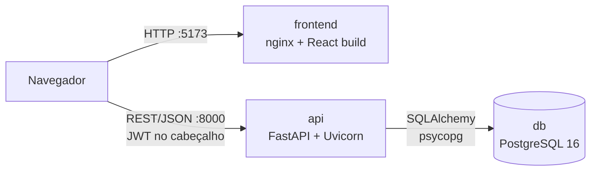
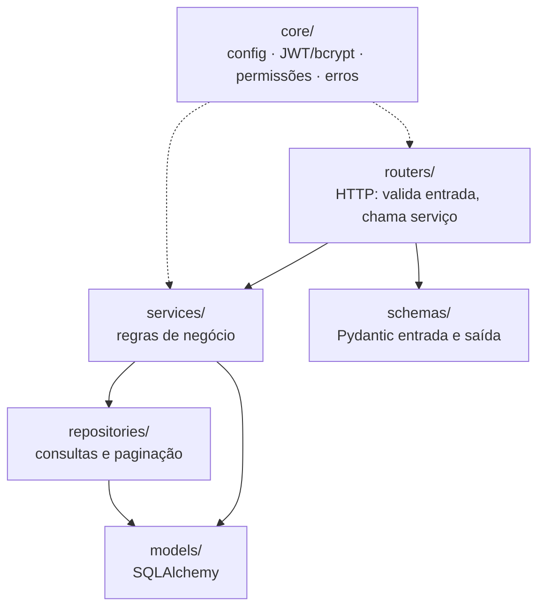
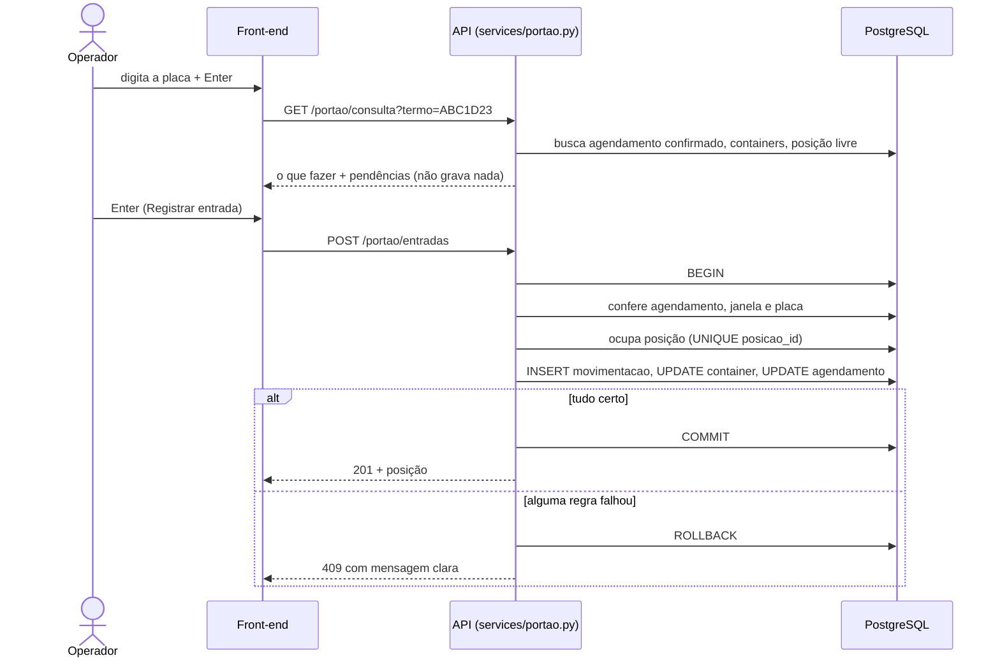

# Arquitetura

## Visão geral



São três serviços no `docker-compose.yml`:

| Serviço | Imagem | Porta | Na subida |
| --- | --- | --- | --- |
| `db` | `postgres:16-alpine` | interna | healthcheck com `pg_isready`; dados no volume `dados_pg` |
| `api` | `backend/Dockerfile` (Python 3.12) | 8000 | `alembic upgrade head` → `python seed.py` → `uvicorn` |
| `frontend` | `frontend/Dockerfile` (Node 22 no build, nginx no runtime) | 5173 | serve o build estático; rotas da SPA caem no `index.html` |

O navegador chama a API direto em `http://localhost:8000`. O CORS libera só a origem do front-end
(`CORS_ORIGEM` no `.env`).

## Back-end em camadas



- **routers** não têm regra de negócio: só recebem, chamam o serviço e devolvem a resposta.
- **services** concentram as regras: ISO 6346, vagas, gate-in/out, empilhamento, transições de status.
  Total, status e posição são sempre decididos no servidor; o que o front-end envia não é confiável.
- **core/errors.py** é o tratamento centralizado de erros: toda resposta de erro tem o formato
  `{"erro": {"codigo", "mensagem", "detalhes"?}}`.
- **core/deps.py** cuida das permissões: sem token, ou com token inválido, a resposta é 401; papel errado dá 403.

## Fluxo transacional do gate-in



## Front-end

| Item | Escolha |
| --- | --- |
| Build | Vite |
| Rotas | React Router (`App.jsx`), com `RotaProtegida` por papel |
| Estado compartilhado | `AuthContext` (usuário e token) e `SelecaoContext` (o "carrinho" de containers) |
| Dados da API | Axios (`api.js`) + TanStack Query: cache, estados de carregando e erro, invalidação após mutações |
| Componentes | Mantine (acessível: labels, foco, teclado, tema claro e escuro) + ícones Tabler |
| Reutilizáveis | `Estado` (carregando/erro/vazio), `BadgeStatus`, `Cabecalho`, `Codigo`, `DetalheContainer`, `FormContainer`, `MoverModal`, `ItemPortao` |

## Estrutura de pastas

```
portoflow/
├── docker-compose.yml       db + api + frontend
├── .env.example             variáveis sem valores reais
├── .github/workflows/       CI: migrations + seed no Postgres e pytest
├── docs/                    esta documentação
├── backend/
│   ├── app/{core,models,schemas,repositories,services,routers}
│   ├── alembic/versions/    migration única do schema
│   ├── seed.py              carga inicial idempotente
│   └── tests/{unit,api}     216 testes
└── frontend/
    └── src/{pages,components,contexts,util}
```
