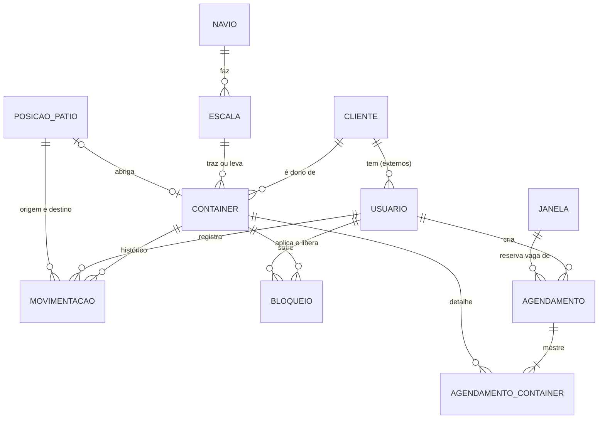

# Modelagem do banco de dados

O banco tem **11 tabelas** e é criado só pela migration Alembic
[`0001_schema_inicial.py`](../backend/alembic/versions/0001_schema_inicial.py). Os modelos SQLAlchemy estão em
[`backend/app/models/`](../backend/app/models/).

## Modelo conceitual (DER)

O equivalente do `pedido → item_pedido → produto` da loja virtual é
**`agendamento → agendamento_container → container`**: um caminhão (agendamento) leva 1 ou 2 containers. É a
relação N:N, ou mestre-detalhe, exigida no item 2.2 do enunciado.

## Modelo lógico

Convenções: `PK` chave primária, `FK` chave estrangeira, `UQ` único, `CK` check, `IX` índice.
Datas usam `TIMESTAMPTZ`, ou seja, `DateTime(timezone=True)`.

### cliente
| Coluna | Tipo | Restrições |
| --- | --- | --- |
| id | SERIAL | PK |
| razao_social | VARCHAR(150) | NOT NULL |
| cnpj | VARCHAR(14) | NOT NULL, UQ (só dígitos) |
| ativo | BOOLEAN | NOT NULL, default true |
| criado_em | TIMESTAMPTZ | NOT NULL, default now() |

### usuario
| Coluna | Tipo | Restrições |
| --- | --- | --- |
| id | SERIAL | PK |
| nome | VARCHAR(120) | NOT NULL |
| email | VARCHAR(254) | NOT NULL, UQ |
| senha_hash | VARCHAR(100) | NOT NULL (bcrypt) |
| papel | VARCHAR(20) | NOT NULL, CK `IN ('admin','operador','externo')` |
| status | VARCHAR(20) | NOT NULL, CK `IN ('pendente','ativo','inativo')` |
| cliente_id | INTEGER | FK → cliente ON DELETE RESTRICT, IX |
| criado_em | TIMESTAMPTZ | NOT NULL |

CK `externo_com_cliente`: `papel <> 'externo' OR cliente_id IS NOT NULL`.

### navio
| Coluna | Tipo | Restrições |
| --- | --- | --- |
| id | SERIAL | PK |
| nome | VARCHAR(120) | NOT NULL |
| imo | VARCHAR(7) | NOT NULL, UQ |
| armador | VARCHAR(120) | NOT NULL |
| ativo | BOOLEAN | NOT NULL |

### escala
| Coluna | Tipo | Restrições |
| --- | --- | --- |
| id | SERIAL | PK |
| navio_id | INTEGER | NOT NULL, FK → navio ON DELETE RESTRICT, IX |
| viagem | VARCHAR(20) | NOT NULL |
| eta / etd | TIMESTAMPTZ | NOT NULL (previsão de atracação e de saída) |
| ata / atd | TIMESTAMPTZ | atracação e saída reais |
| status | VARCHAR(20) | NOT NULL, CK `IN ('prevista','atracada','encerrada')` |
| ativo | BOOLEAN | NOT NULL |

UQ `(navio_id, viagem)` · CK `etd > eta`.

### posicao_patio
| Coluna | Tipo | Restrições |
| --- | --- | --- |
| id | SERIAL | PK |
| bloco | VARCHAR(5) | NOT NULL |
| fileira | INTEGER | NOT NULL, CK `> 0` |
| pilha | INTEGER | NOT NULL, CK `> 0` |
| altura | INTEGER | NOT NULL, CK `BETWEEN 1 AND 5` |

UQ `(bloco, fileira, pilha, altura)`. O endereço legível é `A-01-02-3`.

### container
| Coluna | Tipo | Restrições |
| --- | --- | --- |
| id | SERIAL | PK |
| codigo | VARCHAR(11) | NOT NULL, IX; **UQ parcial `WHERE ativo`** |
| tamanho | INTEGER | NOT NULL, CK `IN (20, 40)` |
| tipo | VARCHAR(10) | NOT NULL, CK `IN ('dry','reefer')` |
| peso_kg | **NUMERIC(10,2)** | NOT NULL, CK `> 0` |
| cheio | BOOLEAN | NOT NULL |
| perigoso | BOOLEAN | NOT NULL |
| status | VARCHAR(20) | NOT NULL, IX, CK `IN ('aguardando_chegada','no_patio','saiu')` |
| bloqueado | BOOLEAN | NOT NULL |
| posicao_id | INTEGER | FK → posicao_patio ON DELETE RESTRICT, **UQ** (1 container por posição) |
| cliente_id | INTEGER | NOT NULL, FK → cliente ON DELETE RESTRICT, IX |
| escala_id | INTEGER | NOT NULL, FK → escala ON DELETE RESTRICT, IX |
| ativo | BOOLEAN | NOT NULL |
| criado_em | TIMESTAMPTZ | NOT NULL |

### movimentacao
| Coluna | Tipo | Restrições |
| --- | --- | --- |
| id | SERIAL | PK |
| container_id | INTEGER | NOT NULL, FK → container ON DELETE RESTRICT, IX |
| tipo | VARCHAR(10) | NOT NULL, CK `IN ('gate_in','gate_out','remocao')` |
| origem_id / destino_id | INTEGER | FK → posicao_patio ON DELETE RESTRICT |
| usuario_id | INTEGER | NOT NULL, FK → usuario ON DELETE RESTRICT |
| observacao | VARCHAR(255) | justificativa (ex.: placa divergente) |
| criado_em | TIMESTAMPTZ | NOT NULL |

### bloqueio
| Coluna | Tipo | Restrições |
| --- | --- | --- |
| id | SERIAL | PK |
| container_id | INTEGER | NOT NULL, FK → container ON DELETE RESTRICT, IX |
| motivo | VARCHAR(255) | NOT NULL |
| criado_por / liberado_por | INTEGER | FK → usuario ON DELETE RESTRICT |
| criado_em / liberado_em | TIMESTAMPTZ | o bloqueio está aberto enquanto `liberado_em` for NULL |

### janela
| Coluna | Tipo | Restrições |
| --- | --- | --- |
| id | SERIAL | PK |
| inicio / fim | TIMESTAMPTZ | NOT NULL, IX em `inicio`; CK `fim > inicio` |
| vagas_total | INTEGER | NOT NULL, CK `> 0` |
| vagas_livres | INTEGER | NOT NULL, CK `BETWEEN 0 AND vagas_total` |

### agendamento (mestre)
| Coluna | Tipo | Restrições |
| --- | --- | --- |
| id | SERIAL | PK |
| numero | VARCHAR(12) | NOT NULL, UQ (ex.: `AG1A2B3C4D`) |
| janela_id | INTEGER | NOT NULL, FK → janela ON DELETE RESTRICT, IX |
| usuario_id | INTEGER | NOT NULL, FK → usuario ON DELETE RESTRICT, IX |
| operacao | VARCHAR(10) | NOT NULL, CK `IN ('entrega','retirada')` |
| placa | VARCHAR(7) | NOT NULL |
| motorista | VARCHAR(120) | NOT NULL |
| status | VARCHAR(12) | NOT NULL, CK `IN ('confirmado','cumprido','cancelado')` |
| criado_em | TIMESTAMPTZ | NOT NULL |

### agendamento_container (detalhe)
| Coluna | Tipo | Restrições |
| --- | --- | --- |
| agendamento_id | INTEGER | PK, FK → agendamento **ON DELETE CASCADE** |
| container_id | INTEGER | PK, FK → container ON DELETE RESTRICT, IX |

## Regras cobradas e como foram atendidas

| Regra do enunciado | No PortoFlow |
| --- | --- |
| Valores em NUMERIC(10,2), nunca FLOAT | `container.peso_kg NUMERIC(10,2)`. FLOAT é binário e não representa 0,1 com exatidão (`0.1*3 = 0.30000000000000004`); somas de peso acumulariam erro. A API devolve o valor como texto (`"12500.50"`) para não perder precisão no JSON. Ver o teste `test_container_peso_e_decimal_exato`. |
| Preço do momento da compra no item | `movimentacao` guarda origem e destino do momento: mover o container depois não altera o histórico. |
| NOT NULL, UNIQUE, CHECK e FK com ação de exclusão | Ver as tabelas acima. São testadas direto no banco em `tests/unit/test_restricoes_banco.py`. |
| Soft delete | `ativo` em cliente, navio, escala e container; `status = 'inativo'` em usuário. O código do container é único só entre os ativos (índice parcial), então dá para reaproveitar um código depois de desativado. |
| Índices de busca e filtro | `container.codigo`, `status`, `escala_id`, `cliente_id`; `agendamento.janela_id`, `usuario_id`; `movimentacao.container_id`; `janela.inicio`. |
| Onde vive o carrinho (justificar) | A seleção de containers antes de agendar fica **no front-end** (`SelecaoContext`). Ela só vira dado quando a vaga é reservada; guardar seleções abandonadas no banco não traria ganho e ocuparia vagas indevidamente. |
| Transação única com 409 | Agendar: `SELECT ... FOR UPDATE` na janela, confere a vaga, baixa a vaga e grava o agendamento e os itens. Gate-in: confere o agendamento, ocupa a posição, grava a movimentação e muda o status. Se qualquer regra falhar, nada é gravado e a API devolve 409 com mensagem. |

## Por que `ON DELETE RESTRICT` quase sempre

O histórico de um terminal tem valor legal e operacional: quem moveu o quê, quando, e por que um container foi
bloqueado. Por isso nenhuma exclusão apaga registros relacionados em cascata. A única cascata é
`agendamento → agendamento_container`, porque o item não existe sem o agendamento. Na prática, a API desativa
os registros em vez de apagá-los.
